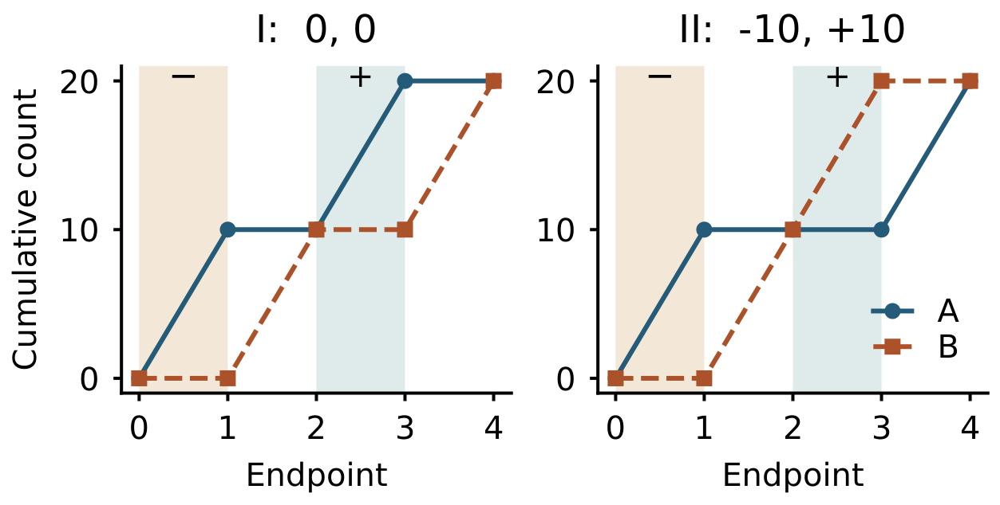
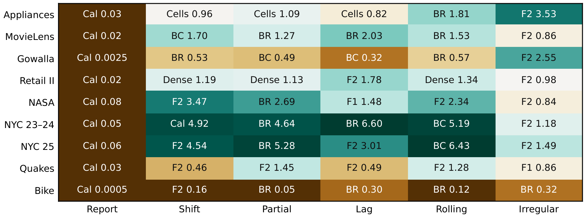

# BlockDrift

*Exact Top-k Changes Between Historical Windows from Paired Prefix Bounds*

BlockDrift ranks keys by the magnitude of their count change and returns the signed difference. The two histories below have the same endpoint count distributions. Pairing counts by key distinguishes them.



### Window comparisons



A ratio above 1 favors BlockDrift. On ordinary windows, full-word BlockDrift beat the fastest independent control on seven of nine snapshots. Fixing the endpoint pairing preserved all seven wins.

### Run the exactness check

On x64 Windows with Visual Studio C++ Build Tools and Python 3.10+:

```powershell
.\build.cmd
python run_example.py
```

The driver reads [time and key pairs](data/facts.csv), enumerates both windows and tests *k* = 1, 3 and 6. It checks the key order and signed changes against direct counts for 1,323 requests per execution path.
